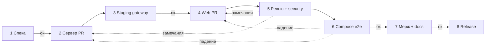

# Оркестратор фичи Carelink

Канонический процесс. Команда Cursor: **`/orchestrate <фича>`** (`cursor/shared/commands/orchestrate.md`).

## Перед стартом (обязательно)

1. Прочитай в **CarelinkMemory**: `README.md`, `product/decisions.md`, `architecture/overview.md`, `status.md`, `process/checklists/*`.
2. `<slug>` = kebab-case от имени фичи (латиница).
3. Создай `features/<slug>/` из `features/_template/` (PR в CarelinkMemory, если ещё нет).
4. Веди **`features/<slug>/status.md`** после каждого этапа (дата, PR, ⬜/🟡/⏸/✅/⛔).
5. Правила процесса: `cursor/shared/rules/carelink-process.mdc`. Коммиты: **`cursor/shared/skills/carelink-commit/SKILL.md`** — прочитать перед **каждым** `git commit`.
6. Одна задача = ветка `cursor/<slug>-<этап>` = один PR; **не пушить в `main`**, **не мержить без «ок»** Славы; без ПДн/секретов; непроверенное — ❓.

## Цикл внутри каждого этапа

план → реализация → пробелы против плана/спеки/чек-листов → закрытие → повтор, пока пробелов нет.

## Этапы

| # | Этап | Репо / где | Критерий готовности |
|---|------|------------|---------------------|
| 1 | **Спека** | CarelinkMemory `features/<slug>/spec.md` | Сценарии **Дано / Когда / Тогда** (позитив + негатив); **дельта OpenAPI** (эндпоинты, поля, коды ошибок); влияние на ПДн. **Гейт «ок».** |
| 2 | **Сервер** | CarelinkAuth, PR `cursor/<slug>-server` | Код, unit-тесты, обновлённый `auth.openapi.yaml`, CI зелёный. |
| 3 | **Проверка запросов** | Staging Railway | Деплой ветки сервера; по каждому сценарию спеки — curl/GraphQL к gateway **https://gateway-staging-0a47.up.railway.app**; лог запросов/ответов **без ПДн** в отчёт. **Гейт «ок».** Без зелёного — web не начинаем. |
| 4 | **Web** | CarelinkWeb, PR `cursor/<slug>-web` | Строго под утверждённый контракт: `pnpm contracts:check` зелёный; Playwright (и при необходимости Cypress compose) на сценарии спеки. |
| 5 | **Ревью + безопасность** | Оба PR | **Независимый** агент (не автор) по `process/checklists/review.md` и `security.md`. Замечания → автор → повтор, пока список пуст. |
| 6 | **Интеграционный e2e** | compose | `docker compose`: web + gateway + auth + redis; все сценарии спеки, **включая негативные**; `process/checklists/definition-of-done.md`. **Гейт «ок» перед мержем.** |
| 7 | **Мерж + docs** | Все затронутые репо + Memory | Мерж PR сервера и web **только после «ок»**; PR в CarelinkMemory: `features/<slug>/status.md`, `status.md`, `log/`, при необходимости `decisions.md` / `architecture/`; идеи → `ideas/backlog.md`. |
| 8 | **Release** | CarelinkAuth, CarelinkWeb, Carelink | Skill **`carelink-release`**: единый SemVer, CHANGELOG, теги и GitHub Release **после «ок»** на релиз. |

## Отчёт на каждом гейте «ок»

- Простое объяснение (3–6 предложений): что сделано, что проверено, что осталось.
- Mermaid (флоу или sequence).
- Ссылки на PR, CI, логи staging/e2e; список ❓.
- Вопрос: **«ок / правки?»**

## Связанные навыки

| Этап | Skill / команда |
|------|-----------------|
| Спека (глубокий gap) | CarelinkAuth: `logic-gap-analyzer`, `/gap-analyze` |
| Web e2e внутри этапа 4/6 | CarelinkWeb: `e2e-*`, `/e2e-flow` |
| Коммиты | `carelink-commit` |
| Релиз | `carelink-release` |

## Ограничения

См. `cursor/shared/rules/carelink-process.mdc`: не удалять `main`/репозитории, не force-push в `main`, не мержить без «ок».

## Если блокер

Не обходить гейты. Зафиксировать ⛔ в `features/<slug>/status.md` и сообщить владельцу.
