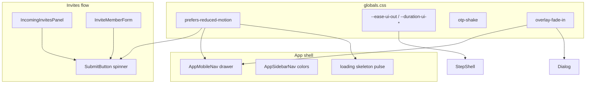

# Аудит анимаций Carelink Web

**Дата:** 2026-10-13  
**Коммит аудита:** `3da96b5` (ветка `cursor/animation-audit-invites-d82c`)  
**Метод:** [review-animations](https://github.com/emilkowalski/skills/tree/main/skills/review-animations) + [improve-animations](https://github.com/emilkowalski/skills/tree/main/skills/improve-animations)  
**Источник правды по UI:** `DESIGN.md`, бренд «Спокойная забота», аудитория — семьи и старшие пользователи.

---

## 1. Разведка (recon)

| Параметр               | Значение                                                                                                                                            |
| ---------------------- | --------------------------------------------------------------------------------------------------------------------------------------------------- |
| Стек                   | Next.js 16, React 19, Tailwind CSS v4 (`@theme` в `src/styles/globals.css`)                                                                         |
| Библиотеки motion      | **Нет** Framer Motion / GSAP; Radix Dialog; Sonner (тосты — дефолтная анимация библиотеки)                                                          |
| Где живёт motion       | `globals.css` (`prefers-reduced-motion`, `@keyframes`), utility-классы Tailwind (`transition-*`, `animate-*`)                                       |
| Токены движения в коде | Глобальный reduce-motion; `@keyframes otp-shake`; после этого PR — `--ease-ui-out`, `--duration-ui-fast`, `--duration-ui-drawer`, `overlay-fade-in` |
| Характер продукта      | Спокойный семейный продукт: короткие, редкие переходы; без «вау»-эффектов; приоритет — ясность и доступность                                        |

**Частота (frequency map):**

| Зона             | Элементы                        | Частота                                           | Рекомендация по философии Emil K.                |
| ---------------- | ------------------------------- | ------------------------------------------------- | ------------------------------------------------ |
| Приглашения      | Accept/decline, формы, списки   | Десятки раз в сессию при активной настройке семьи | Без декора; только feedback (loading, ошибки)    |
| Навигация        | `AppSidebarNav`, мобильное меню | Десятки/день                                      | Минимум hover; drawer — умеренно                 |
| Auth / онбординг | `StepShell`, OTP                | Редко / первый раз                                | Прогресс и OTP-shake допустимы                   |
| Карточки семей   | `FamilyCard` hover              | Средняя                                           | Hover-тень — снизить или ограничить pointer:fine |

---

## 2. Поток приглашений (invites)

**Маршруты и UI:** `/invite`, `/invites`, `/families/[id]/invites/*`, компоненты `IncomingInvitesPanel`, `InviteMemberForm`, `FamilyInvitesList`, `PublicInviteLanding`, `InviteSentPanel`.

**Вывод:** в потоке приглашений **нет собственных** CSS-анимаций или transition-классов. Состояния загрузки и ошибок идут через `SubmitButton` / `Button` (`animate-spin`), `FormAlert` — без motion. Пустые состояния и карточки приглашений статичны.

| Аспект                 | Оценка                                                                                                                    |
| ---------------------- | ------------------------------------------------------------------------------------------------------------------------- |
| Accept / decline       | Мгновенная смена текста кнопок («Отклонено») — без crossfade; для спокойного тона **нормально**                           |
| Loading                | Spinner на «Принять» — уместный feedback; глобальный `prefers-reduced-motion` + `motion-reduce:animate-none` на спиннерах |
| Ошибки                 | `FormAlert` без анимации — хорошо для частых повторов                                                                     |
| Навигация к `/invites` | Через sidebar (см. общий аудит)                                                                                           |

**Риски только косвенные:** общие примитивы (`Button`, `loading.tsx` → `FamiliesPageSkeleton`) используются и вне invites; исправления примитивов улучшают и invites.

---

## 3. Таблица находок (review-animations)

| Before                                                                                             | After                                                                                          | Why                                                                                    |
| -------------------------------------------------------------------------------------------------- | ---------------------------------------------------------------------------------------------- | -------------------------------------------------------------------------------------- |
| `StepShell`: `width` + `transition-all` на полосе прогресса                                        | `transform: scaleX()` + `transition-transform` + токены `--duration-ui-fast` / `--ease-ui-out` | `width` и `transition: all` — layout/off-GPU; прогресс — линейное морфинг, ≤300ms      |
| `dialog.tsx` / `AppMobileNav`: классы `animate-in`, `slide-in-from-left` без `tailwindcss-animate` | `@keyframes overlay-fade-in` + `motion-safe:animate-[…]`; drawer — `translate-x` + transition  | Классы shadcn не генерировались — ложное ощущение motion; overlay только opacity (GPU) |
| `FamilyCard`: `hover:shadow-md` без gating                                                         | `motion-safe` + `@media (hover:hover) and (pointer:fine)`                                      | На touch ложный hover; частый список семей                                             |
| Спиннеры без явного `motion-reduce`                                                                | `motion-reduce:animate-none` на `Loader2`                                                      | Дублирует глобальный reduce, но явно для a11y-ревью                                    |
| Нет токенов easing/duration в `@theme`                                                             | `--ease-ui-out`, `--duration-ui-fast`, `--duration-ui-drawer`                                  | Согласованность; `DESIGN.md` §1.6 пока без таблицы — см. план ниже                     |
| `OtpInput`: shake 300ms `ease-in-out`                                                              | _(без изменения в PR)_                                                                         | Уже отключён при `prefers-reduced-motion` в JS; глобальный reduce сжимает keyframes    |
| `AppSidebarNav`: `transition-colors` на каждой ссылке                                              | _(без изменения)_                                                                              | Десятки раз/день — кандидат на удаление или только `motion-safe`                       |
| Sonner: дефолтные анимации пакета                                                                  | _(без изменения)_                                                                              | Нужна отдельная настройка `toastOptions` / CSS, без новых deps                         |
| Dialog **content** без enter/exit                                                                  | _(by design для calm UI)_                                                                      | Модалка по центру — instant допустим; overlay fade достаточно                          |
| Drawer close без exit-animation                                                                    | _(ограничение Radix mount)_                                                                    | Transition на close требует presence/CSS exit; отдельный план                          |

### Вердикт (review)

1. **Feel-breaking:** устранено в PR — мёртвые `animate-in` на overlay/drawer; прогресс больше не анимирует `width`.
2. **Упрощения:** invites-flow уже минималистичен — сохранять.
3. **Performance:** исправлен `StepShell`; hover-тень на карточках ограничена.
4. **Interruptibility:** toasts Sonner — transitions внутри библиотеки; не трогали.
5. **Origin / cohesion:** drawer слева + strong ease-out; соответствует спокойному, но отзывчивому тону.
6. **A11y:** глобальный `@media (prefers-reduced-motion: reduce)` в `globals.css`; OTP shake gated; спиннеры явно.

**Решение:** **Approve** для области изменений PR при условии прогона CI. Оставшиеся MEDIUM/LOW — в планах ниже.

---

## 4. Приорitized backlog (improve-animations)

| #   | Severity | Категория           | Location                                                | Finding                             | Fix summary                                                              |
| --- | -------- | ------------------- | ------------------------------------------------------- | ----------------------------------- | ------------------------------------------------------------------------ |
| 1   | HIGH     | Performance         | `StepShell.tsx:52`                                      | `transition-all` + `width`          | ✅ `scaleX` + transform transition                                       |
| 2   | HIGH     | Cohesion / a11y     | `dialog.tsx`, `AppMobileNav.tsx`                        | Мёртвые tailwind-animate классы     | ✅ keyframes + transform drawer                                          |
| 3   | MEDIUM   | Accessibility       | `FamilyCard.tsx:13`                                     | Hover shadow без pointer gating     | ✅ media hover                                                           |
| 4   | MEDIUM   | Accessibility       | `button.tsx`, `SubmitButton.tsx`, `KeeperWaitPanel.tsx` | Spinner при reduce                  | ✅ `motion-reduce:animate-none`                                          |
| 5   | MEDIUM   | Cohesion & tokens   | `DESIGN.md` §1.6                                        | Нет таблицы токенов motion в DESIGN | Документировать `--ease-ui-out`, durations после стабилизации            |
| 6   | MEDIUM   | Purpose & frequency | `AppSidebarNav.tsx:46`                                  | `transition-colors` на nav          | Убрать или `motion-safe:transition-colors`                               |
| 7   | LOW      | Easing              | `OtpInput.tsx:114`                                      | `ease-in-out` на shake              | На reduce уже off; опционально `ease-out` 200ms                          |
| 8   | LOW      | Physicality         | `button.tsx`                                            | Нет `:active` scale 0.97            | `active:scale-[0.98]` + transform transition 160ms, только `motion-safe` |
| 9   | LOW      | Interruptibility    | `AppMobileNav.tsx`                                      | Нет exit slide                      | Radix + `@starting-style` / data-state closed transition                 |
| 10  | LOW      | Cohesion            | `sonner.tsx`                                            | Дефолтный motion Sonner             | Подстроить duration/easing под `--ease-ui-out` через CSS vars            |

### Упущенные возможности (не баги)

- **InviteSentPanel / empty states:** мягкий fade-in контента (opacity only, once) — редкий экран, budget на delight минимален; не обязательно.
- **Список входящих приглашений:** stagger 30–50ms — декоративно; для старших пользователей может отвлекать — **не рекомендуем**.

---

## 5. Планы реализации (шаблон для follow-up)

### 005 — Задокументировать motion-токены в DESIGN.md

- **Status:** TODO
- **Severity:** MEDIUM
- **Category:** Cohesion & tokens

**Problem:** В `@theme` появились `--ease-ui-out`, `--duration-ui-fast`, `--duration-ui-drawer`, но `DESIGN.md` §1.6 перечисляет только reduce-motion и otp-shake.

**Target:** Таблица в §1.6 с назначением токенов и правилом «сначала `globals.css`, потом DESIGN.md».

**Steps:** 1) Обновить `DESIGN.md`. 2) При необходимости — swatch/примечание в `DevKitShowcase`.

**Verification:** `pnpm lint`; визуально — прогресс в StepShell и drawer используют те же значения, что в доке.

---

### 006 — Упростить motion в sidebar nav

- **Status:** TODO
- **Severity:** MEDIUM
- **Category:** Purpose & frequency

**Problem:** `AppSidebarNav.tsx:46` — `transition-colors` на ссылках, включая пункт «Приглашения».

**Target:** Удалить transition или обернуть в `motion-safe:transition-colors duration-150`.

**Verification:** Клик по nav, включая `/invites` — мгновенная смена фона без «запаздывания».

---

### 007 — Exit-animation мобильного меню

- **Status:** TODO
- **Severity:** LOW
- **Category:** Interruptibility

**Problem:** Drawer открывается с transition, закрытие может быть мгновенным из-за unmount Radix.

**Target:** CSS `data-[state=closed]` + transition на `transform`, проверить поведение Radix Dialog; при необходимости `forceMount` + pointer-events none — только если не ломает a11y.

**Verification:** DevKit / реальное устройство; `prefers-reduced-motion: reduce` — без slide.

---

## 6. Что сделано в этом PR

| Файл                                                                      | Изменение                                    |
| ------------------------------------------------------------------------- | -------------------------------------------- |
| `src/styles/globals.css`                                                  | Токены motion; `@keyframes overlay-fade-in`  |
| `src/components/carelink/StepShell.tsx`                                   | GPU progress bar                             |
| `src/components/ui/dialog.tsx`                                            | Рабочий fade overlay                         |
| `src/components/carelink/AppMobileNav.tsx`                                | Убраны мёртвые классы; slide через transform |
| `src/components/carelink/FamilyCard.tsx`                                  | Gated hover shadow                           |
| `src/components/ui/button.tsx`, `SubmitButton.tsx`, `KeeperWaitPanel.tsx` | `motion-reduce` на спиннерах                 |

---

## 7. Проверка

```bash
pnpm install --frozen-lockfile
pnpm lint && pnpm typecheck && pnpm build
```

**Feel-check (ручной):**

1. Онбординг / любой экран с `StepShell` — полоса шага плавно растёт без дёргания layout.
2. Мобильное меню (≤lg) — overlay слегка проявляется, панель выезжает слева; с reduce-motion — почти мгновенно.
3. `/invites` — accept/decline: spinner только на submit; без лишних переходов.
4. DevTools → Rendering → Emulate prefers-reduced-motion — нет shake OTP (ошибка), спиннеры статичны.

---

## 8. Диаграмма поверхности motion


